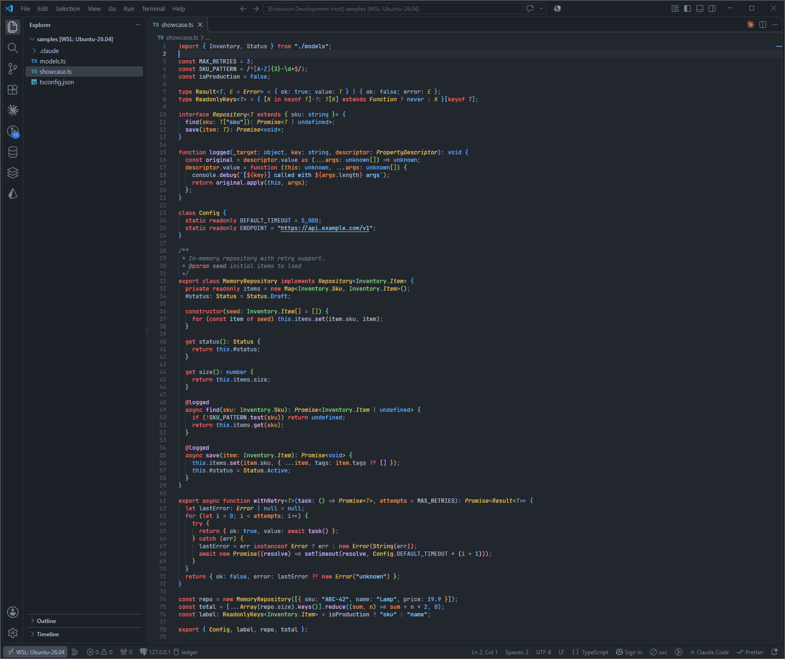
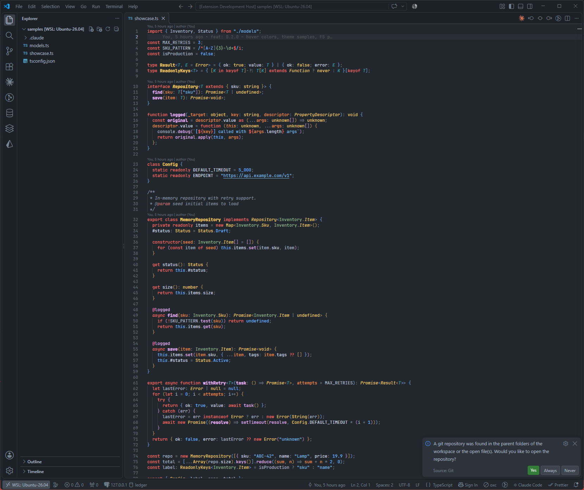

# Dimmed TypeScript

A dimmed dark theme for VS Code, tuned for TypeScript. Built on the
GitHub Dark Dimmed (Primer `dark_dimmed`) palette, with extra roles so
TypeScript constructs get distinct colors.

## Palette

| Role                              | Color     |
| --------------------------------- | --------- |
| Editor background                 | `#22272e` |
| Sidebar / panels                  | `#1c2128` |
| Widgets                           | `#2d333b` |
| Foreground / variables            | `#adbac7` |
| Comments                          | `#768390` |
| Keywords / storage / import       | `#f47067` |
| Functions / methods               | `#dcbdfb` |
| Types / classes / interfaces      | `#eac55f` |
| Type parameters                   | `#daaa3f` |
| Strings                           | `#96d0ff` |
| Numbers / constants / primitives  | `#6cb6ff` |
| Parameters                        | `#f69d50` |
| Properties                        | `#a3b8cc` |
| Namespaces / regex / JSON keys    | `#8ddb8c` |
| Decorators                        | `#e275ad` |

Semantic highlighting is on, so TypeScript's language service colors
interfaces (italic), type parameters, readonly variables and enum members.

## Dimmed TypeScript Refined

A second variant, tuned with perceptual color metrics (APCA contrast,
OKLCH lightness, and color distance under simulated color blindness).
The background and UI colors are the same. The differences are:

- Type parameters are teal, so they no longer look like parameters
  (the two were almost identical for red-green color blindness).
- Lightness follows three tiers. Functions, types and properties are a
  little brighter than variables. Strings and green tokens are about
  as bright as variables, so they no longer stand out more than the code around them.
- Comments are brighter and easier to read. Punctuation and operators are
  dimmer, so the prose in comments outranks semicolons and brackets.
- Properties use a brighter neutral that is clearly distinct from
  variables. Readonly variables use the plain variable color.
- Primitive types (`string`, `number`) use the type color.
- Green is a muted sage, and JSON and YAML keys use the property color.
- Bracket pair colors are muted, and three hues repeat.
- The find-match highlight is translucent, so token colors show through it.
  Line numbers are slightly brighter.
- Declarations of functions, methods, classes, interfaces, types, enums and
  namespaces are bold (semantic highlighting only).

| Role                              | Color     |
| --------------------------------- | --------- |
| Foreground / variables            | `#adbac7` |
| Properties / JSON and YAML keys  | `#cbd6e1` |
| Comments                          | `#8b98a6` |
| Punctuation / operators           | `#768390` |
| Keywords / storage / import       | `#f47067` |
| Functions / methods               | `#e3b8f1` |
| Types / classes / primitives      | `#ecc865` |
| Type parameters                   | `#38abb1` |
| Strings                           | `#7bbae0` |
| Numbers / constants               | `#6cb6ff` |
| Parameters                        | `#ec9247` |
| Namespaces / regex / JSX tags    | `#97b98f` |
| Decorators                        | `#e275ad` |

## Try it

Open this folder in VS Code and press `F5` to run the **Preview theme** launch configuration. It
starts an Extension Development Host: a second VS Code window with this theme loaded and
[`samples/showcase.ts`](samples/showcase.ts) open. Select **Dimmed TypeScript** or
**Dimmed TypeScript Refined** with **Preferences: Color Theme** in that window.

The sample uses every color role in
the palette: imports, namespaces, enums, generics, decorators, classes, async code, template
strings, regex and JSDoc. [`samples/models.ts`](samples/models.ts) holds the types it imports.

## Install

```bash
npx @vscode/vsce package
code --install-extension dimmed-typescript-theme-0.3.0.vsix
```

Then run **Preferences: Color Theme** and pick **Dimmed TypeScript** or
**Dimmed TypeScript Refined**.

## Sample



